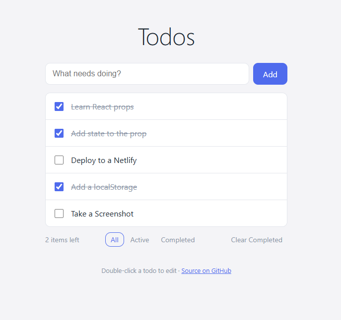

# ✅ Todo App

A clean, responsive todo app built with React. No backend: todos are saved in the browser with localStorage.

**🔗 Live demo:** https://reactapptodoaau.netlify.app/

## Features
- Add, edit (double-click), complete and delete todos
- Filter by All / Active / Completed
- Saves automatically, survives page refreshes
- Keyboard accessible, with automatic dark mode

## Tech
React 19 · Vite · plain CSS · localStorage

## What I learned
- Lifting state up and passing callbacks through props
- Immutable updates with map / filter / spread
- Derived state instead of duplicated state
- Writing a custom hook (`useLocalStorage`) with useState and useEffect

## Run locally
    cd frontend
    npm install
    npm run dev